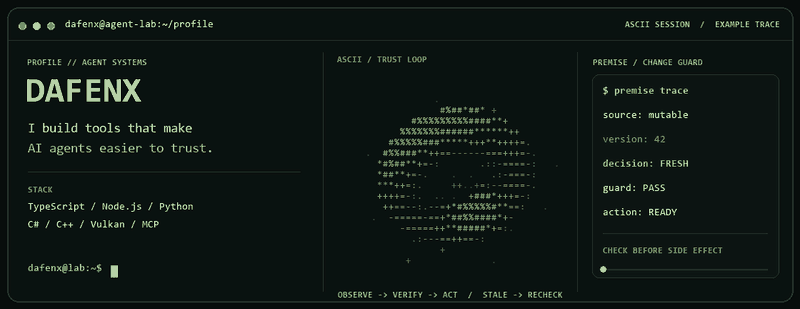
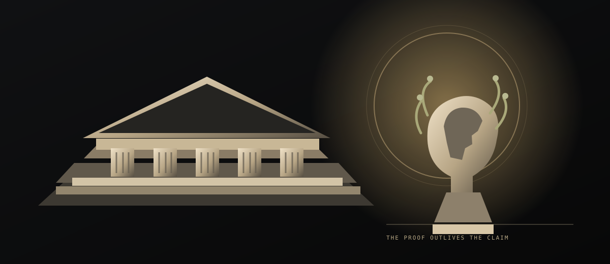

<p align="center">
  <a href="#selected-work"></a>
</p>

<p align="center">
  <a href="#selected-work">Selected work</a> &nbsp;·&nbsp;
  <a href="#how-i-work">How I work</a> &nbsp;·&nbsp;
  <a href="#toolbox">Toolbox</a> &nbsp;·&nbsp;
  <a href="https://github.com/Dafenxz0?tab=repositories">All repositories</a> &nbsp;·&nbsp;
  <a href="https://github.com/pulls?q=is%3Apr+author%3ADafenxz0+-user%3ADafenxz0">Open-source PRs</a>
</p>

## Selected work

<p align="center">
  <a href="https://github.com/Dafenxz0/premise-protocol"></a>
  <a href="https://github.com/Dafenxz0/skillproof"></a>
  <a href="https://github.com/Dafenxz0/statecraft-skill"></a>
</p>

<p align="center">
  More work: <a href="https://github.com/Dafenxz0/healthcheck">healthcheck</a> &nbsp;·&nbsp;
  <a href="https://github.com/Dafenxz0/codex-harness-hub">Codex Harness Hub</a> &nbsp;·&nbsp;
  <a href="https://github.com/Dafenxz0/pando">Pando</a>
</p>

## How I work

<details>
<summary>The rule: check the source again before an agent acts.</summary>

```text
source changes
     |
     v
[observe] --> [derive] --> [guard] --> [act]
                             |
                     stale --+--> [revalidate]
```

</details>

## Toolbox

**Languages:** TypeScript · Python · C# · C++
**Systems:** Node.js · Vulkan · Linux · Docker · GitHub Actions · MCP

<p align="center"><sub>Measure the claim · Keep the evidence · Guard the action · Design the failure</sub></p>
