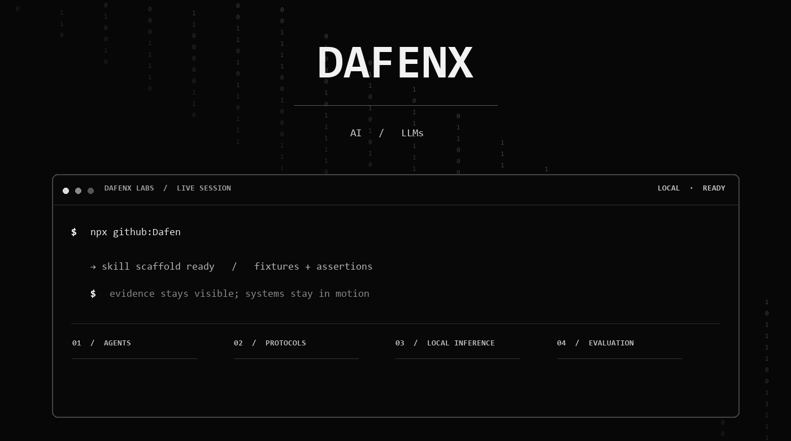
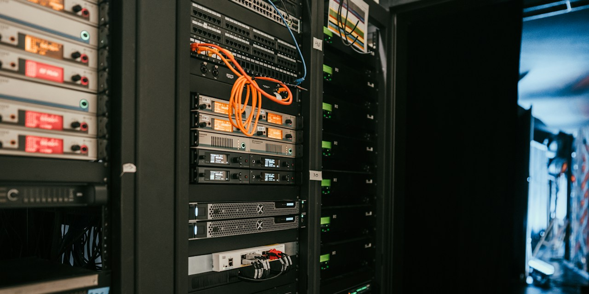
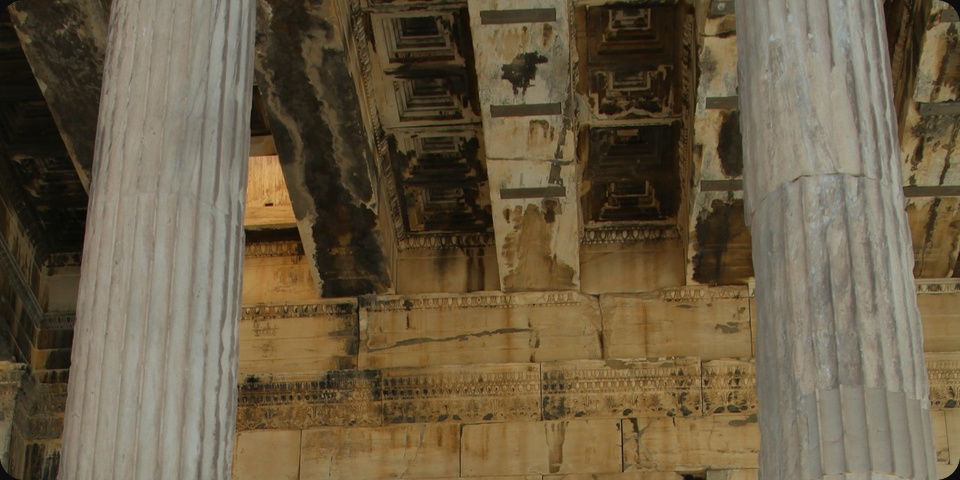
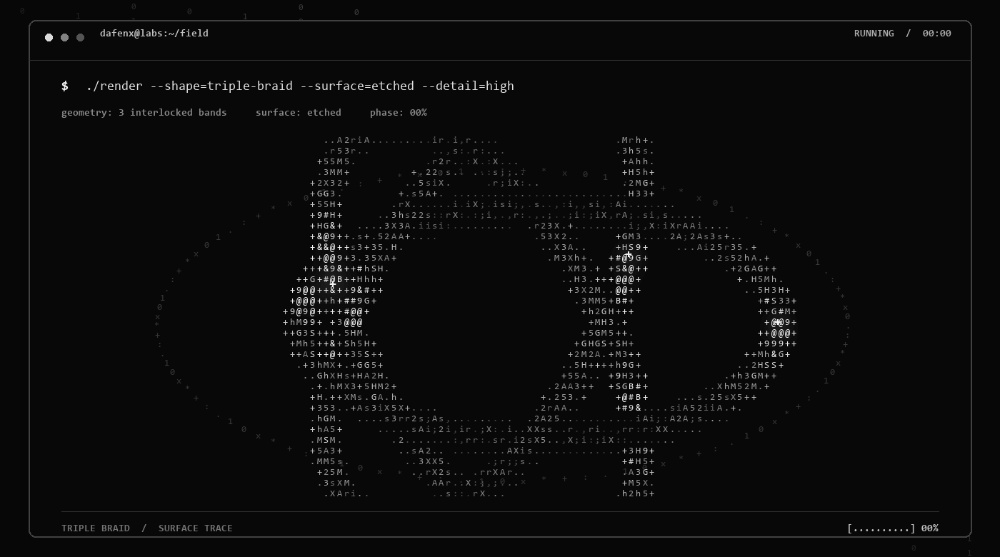
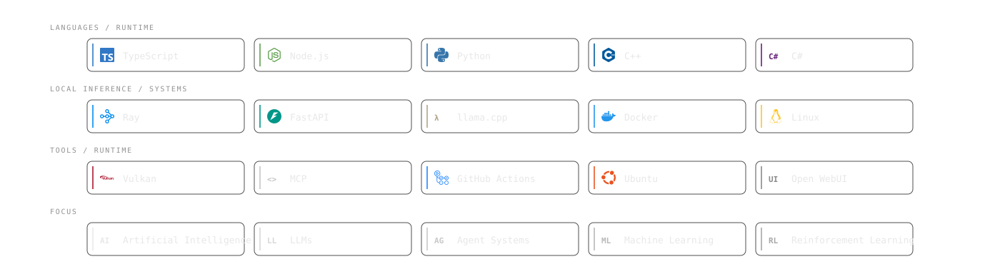
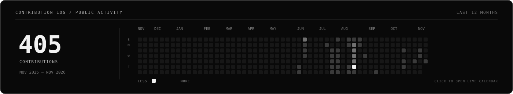
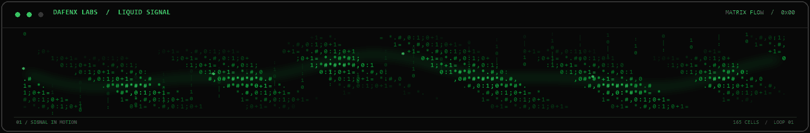

  

## Selected work

<table border="0" cellpadding="12" cellspacing="18" width="100%">
  <tbody>
    <tr>
      <td width="50%" valign="top" bgcolor="#0D0D0D">
        
        
<strong><a href="https://github.com/Dafenxz0/premise-protocol">PREMiSE</a></strong> An evidence-aware protocol that blocks stale agent actions.

        
  

      </td>
      <td width="50%" valign="top" bgcolor="#0D0D0D">
        
        
<strong><a href="https://github.com/Dafenxz0/Cluster">CPU-Only LLM Cluster</a></strong> Distributed inference across commodity PCs, without discrete GPUs.

        
  

      </td>
    </tr>
    <tr>
      <td width="50%" valign="top" bgcolor="#0D0D0D">
        
        
<strong><a href="https://github.com/Dafenxz0/skillproof">SkillProof</a></strong> Compare agent skill runs across quality, regressions, cost and latency.

        
  

      </td>
      <td width="50%" valign="top" bgcolor="#0D0D0D">
        
        
<strong><a href="https://github.com/Dafenxz0/statecraft-skill">Statecraft</a></strong> Design agent interfaces that recover from uncertain states.

        
  

      </td>
    </tr>
  </tbody>
</table>

  

## Stack

  

## Contributions

  

  <a href="https://github.com/sharpemu/sharpemu/pull/627"><code>SharpEmu #627 · GPU / AGC</code></a> &nbsp;
  <a href="https://github.com/sharpemu/sharpemu/pull/538"><code>SharpEmu #538 · CPU / ABI</code></a> &nbsp;
  <a href="https://github.com/sharpemu/sharpemu/pull/484"><code>SharpEmu #484 · Memory</code></a> &nbsp;
  <a href="https://github.com/KytyPS5/KytyPS5/pull/24"><code>KytyPS5 #24 · CTest</code></a>

  

