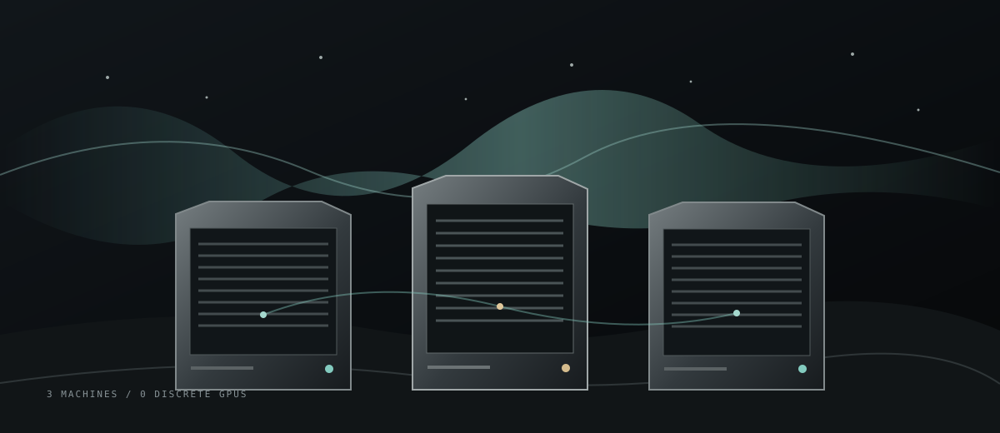

  

  <a href="#selected-work"><kbd> &nbsp; 01 / WORK</kbd></a> &nbsp;
  <a href="#stack"><kbd> &nbsp; 02 / STACK</kbd></a> &nbsp;
  <a href="#more-work"><kbd> &nbsp; 03 / MORE WORK</kbd></a> &nbsp;
  <a href="#open-source"><kbd> &nbsp; 04 / OPEN SOURCE</kbd></a> &nbsp;
  <a href="https://github.com/Dafenxz0?tab=repositories"><kbd> &nbsp; ALL REPOSITORIES ↗</kbd></a>

## Selected work

<table>
  <tr>
    <td width="50%" valign="top">
      
      
01 / COHERENCE PROTOCOL

      <h3><a href="https://github.com/Dafenxz0/premise-protocol">PREMiSE ↗</a></h3>
      
A protocol and runtime that checks the evidence behind an agent's decision against the changing source of truth.

      
<code>TypeScript</code> <code>Node.js</code> <code>Agent systems</code>

    </td>
    <td width="50%" valign="top">
      
      
02 / LOCAL INFERENCE

      <h3><a href="https://github.com/Dafenxz0/Cluster">CPU-Only LLM Cluster ↗</a></h3>
      
Distributed local inference across commodity PCs; routing and concurrency without discrete GPUs.

      
<code>Python</code> <code>Ray</code> <code>FastAPI</code> <code>llama.cpp</code>

    </td>
  </tr>
  <tr>
    <td width="50%" valign="top">
      
      
03 / AGENT EVALUATION

      <h3><a href="https://github.com/Dafenxz0/skillproof">SkillProof ↗</a></h3>
      
A Node.js CLI that compares baseline, automatic and forced skill runs, then keeps evidence for quality, regressions, tokens, cost and latency.

      
<code>Node.js</code> <code>Agent Skills</code> <code>Evaluation</code>

    </td>
    <td width="50%" valign="top">
      
      
04 / INTERFACE CRAFT

      <h3><a href="https://github.com/Dafenxz0/statecraft-skill">Statecraft ↗</a></h3>
      
An agent skill for interfaces that stay useful through loading, empty, blocked, failed and uncertain states, with a way back.

      
<code>Agent Skills</code> <code>UI engineering</code> <code>Recovery</code>

    </td>
  </tr>
</table>

## ASCII field

  

## Stack

  

## More work

<table>
  <tr>
    <td width="33%" valign="top"><h3><a href="https://github.com/Dafenxz0/pando">Pando ↗</a></h3>
One root system, many agent worktrees. A multi-repository coding orchestrator.
<code>Agents</code> <code>Git worktrees</code></td>
    <td width="33%" valign="top"><h3><a href="https://github.com/Dafenxz0/codex-harness-hub">Codex Harness Hub ↗</a></h3>
Discover, evaluate, install and create agent harnesses from one Codex plugin.
<code>TypeScript</code> <code>Codex</code></td>
    <td width="33%" valign="top"><h3><a href="https://github.com/Dafenxz0/forgeboard">Forgeboard ↗</a></h3>
A local-first maintainer queue with release readiness and repository signals.
<code>TypeScript</code> <code>Vite</code></td>
  </tr>
  <tr>
    <td width="33%" valign="top"><h3><a href="https://github.com/Dafenxz0/healthcheck">Healthcheck ↗</a></h3>
Offline repository hygiene checks and lightweight Git activity reports.
<code>Python</code> <code>CLI</code></td>
    <td width="33%" valign="top"><h3><a href="https://github.com/Dafenxz0/codex-maintainer-skills">Codex Maintainer Skills ↗</a></h3>
Issue triage, pull request risk review and release briefs for maintainers.
<code>Codex</code> <code>Agent Skills</code></td>
    <td width="33%" valign="top"><h3><a href="https://github.com/Dafenxz0/reward-server">Reward Server ↗</a></h3>
HTTP inference serving for learned visual reward models.
<code>Python</code> <code>PyTorch</code></td>
  </tr>
</table>

## Open source

  <a href="https://github.com/pulls?q=is%3Apr+author%3ADafenxz0+-user%3ADafenxz0"><kbd> &nbsp; OPEN-SOURCE PULL REQUESTS ↗</kbd></a> &nbsp;&nbsp;
  <a href="https://github.com/Dafenxz0?tab=repositories"><kbd> &nbsp; ALL REPOSITORIES ↗</kbd></a>

